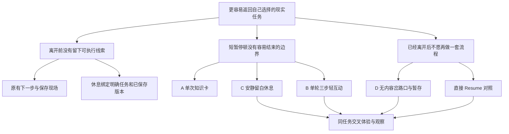

# 机会地图与风险假设

日期：2026-10-22。机会来自用户转述和代码/文献审查，尚未经访谈确认。以下是本项目自己的结构，不复制外部机会树画布。

## 先验证哪种风险

| 风险 ID     | 假设 / 失败后果                                          | 当前依据                         | 最便宜且可否定的检验                                     | 推翻条件                                             |
| ----------- | -------------------------------------------------------- | -------------------------------- | -------------------------------------------------------- | ---------------------------------------------------- |
| H1 价值     | 产生离开冲动时会主动打开一个入口；若不会，功能无触达价值 | 单一朋友转述，低信心             | 询问上次情境，试用后让参与者自由选择，不先指示点休息     | 多数表示只会直接离开，入口本身成为额外负担           |
| H2 返回     | 保留原始下一步足够让人知道回来做什么                     | v0.1 可保存字段，体验证据缺失    | 隐去任务以短暂中断后重开，要求说出下一动作               | 用户仍必须重读大量资料或不理解下一步                 |
| H3 边界     | 明确终点足以抵消轻互动的吸引力                           | 没有本产品数据，低信心           | C/B 相同时长比较；观察结束后复玩/延长意图                | B 更想持续停留或更难表达下一步                       |
| H4 认知负担 | C 比 B 更轻，但不一定更愿意用                            | 一般人群微休息证据，迁移弱       | 同一人两种方案反向排序，问负担与结束感                   | 低刺激造成焦躁，B 单轮更容易结束且无保护指标问题     |
| H5 最小方案 | D 或直接 Resume 已满足需求                               | 简化流程判断，低信心             | 同时允许不休息，记录为什么选直接返回                     | C/B 没带来可指出的额外价值，应缩为 D/Resume          |
| H6 工程     | 休息后能稳定返回同一任务及版本                           | 审计已确认不能依赖 currentTaskId | 原型多窗口变更、归档、关闭重开测试；正式阶段扩展事务测试 | 错误换绑、覆盖新下一步或恢复已删除任务，阻止正式开发 |
| H7 手机     | 手动跨设备入口可能有价值但成本大                         | 没有用户研究、没有技术实现       | 纸面询问分享菜单/PWA方案，不先接同步                     | 必须监控手机才有价值，停止扩展侧承诺                 |

## 候选取舍

A 可带来新奇，但需要持续事实核查、主题筛选和内容维护，既可能缺乏吸引力，也可能吸走注意。B 不需要内容库，但可能把休息变成又一项认知任务。C 最轻、离线且可站起来，但无法保证愿意主动打开。D 和直接 Resume 操作最少，也最容易发现“其实不需要一个休息产品”的结果。

本轮采用 C 与 B 的真实可点击比较，并保留 D/直接 Resume。**正式工程候选为 C/D；B 仅当它在小样本中比 C 更好结束且不触发保护规则时重新评估。A 暂不实现。** 对优先级的估计不是市场需求证据，见[路线图](07_ROADMAP.md)。

每个机会对应的需求编号见 [PRD](05_V02_PRD.md)，实验退出规则见[发布关卡](09_RELEASE_GATES.md)。
