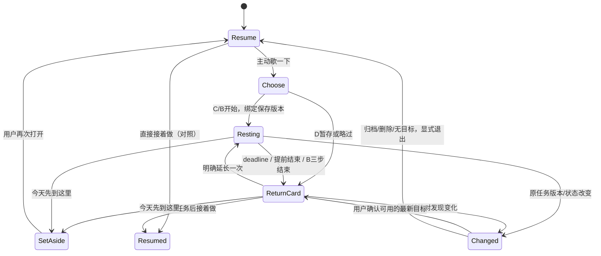

# 交互规格：把路接回原任务

日期：2026-10-22。本文细化 PRD 的 F01–F17，区分本轮网页样例与未来扩展候选。

## 层级、布局与视觉

沿用 v0.1 雾蓝/偏白底、深色正文和小面积蓝色主要动作，系统字体；文字正文16px起、行高约1.5，重点是一句下一步，不增加数据面板。侧栏是 320–480px 可滚动单列，全页面保留窄的任务操作区域，外围研究说明不是第二套导航。

```text
接着来                         语言 / 研究设置
演示样例 · 当前任务
任务标题
下一步：用户保存的原文
[ 接着做 ]                      ← 唯一主动作
歇一下                          ← 次级且只在用户点时展开
先放这里                        ← 独立暂存，非必做
```

休息时把注意力放在“可以停一会儿”而非大号倒计时。剩余时间提供确定边界，可查看但不闪烁，不使用进度得分或渐强动画。B接线是三个按钮对应的确定性动作，没有拖动、输赢、随机奖励或新关卡。默认不播放声音；减少动画时直接显示静态状态。

## 状态机



`Resumed` 在原型只表示“已选择回到样例下一步”；不存在真正课程恢复或生产数据变更。延长上限是整个会话一次，不因重开页面/另窗口而重置；“今天先到这里”终止会话但保留演示任务。

## 边界行为

| 条件                 | 必须呈现与允许动作                                 | 禁止行为                           |
| -------------------- | -------------------------------------------------- | ---------------------------------- |
| 没有任务             | 空状态；明确选择创建演示样例                       | 生成一个看似真实的任务             |
| 没下一步             | “还没有记录”；编辑可选，休息可继续                 | 把规则建议伪装成用户原文           |
| 任务暂停/current为空 | 使用已绑定taskId继续显示                           | 因current为空切换任务              |
| 原任务revision变化   | 显示变化提示；确认最新任务/下一步后才返回          | 沿用过期文字悄悄覆盖新记录         |
| 原任务归档           | 返回操作受限；显式重开样例或退出                   | 自动解除归档                       |
| 原任务删除           | 说明目标不存在，回空状态                           | 打开其他任务冒充原目标             |
| 另一窗口结束/延长    | storage事件读取最新状态，时间戳统一                | 每窗口独立加一次延长               |
| 页面关闭或系统睡眠   | 重开按deadline复算，过期显示返回卡                 | 延迟累加回调导致无限计时           |
| 更改本机时钟         | 由保存deadline计算并限制显示范围；说明本地时钟限制 | 宣称精确计量真实离屏时长           |
| 存储失败/损坏        | 可理解错误或无持久能力说明；不显示保存成功         | 静默清除生产数据/循环重试          |
| 用户仍需长休息       | 一次延长后仍可今天先放下或关界面                   | 羞辱、红色失败状态或不断推荐下一轮 |

## 双语文案约定

| 中文         | 英文                     | 语义                     |
| ------------ | ------------------------ | ------------------------ |
| 接着做       | Resume                   | 用户显式返回，非工作完成 |
| 歇一下       | Take a moment            | 主动、可选               |
| 提前结束     | End early                | 无失败含义               |
| 再休息一会儿 | Rest a little longer     | 显式一次延长             |
| 今天先到这里 | Set this aside for today | 保留任务、结束会话       |
| 还没有记录   | Nothing saved yet        | 缺失事实，不责备         |
| 演示样例     | Demo task                | 与生产任务隔离           |
| 任务有了变化 | This task has changed    | 重新核对目标             |

原型的具体自然文案允许轻微调整，但同一动作应使用同一名称。语言只切界面，不自动翻译样例任务原文。

## 键盘与可访问性验收

Tab按视觉顺序到达所有按钮；Enter/Space操作单轮互动；不需要按住、拖动或限时反应。进入新阶段把焦点放到阶段标题/下一主要动作，退出对话框恢复原入口；不在每秒计时更新时抢焦点。计时文本不作为每秒live region；只播报开始、结束和错误。减少动画可由系统设置或研究控件启用，几何线条为装饰，不以颜色唯一表示步骤状态。

工程检查包含实际浏览器视口、键盘流程、减少动画媒体查询、控制台、网络与独立存储；真人屏幕阅读器/原生浏览器200%缩放另列未验。测试结果见[交付记录](12_DELIVERY_AND_VALIDATION.md)。
